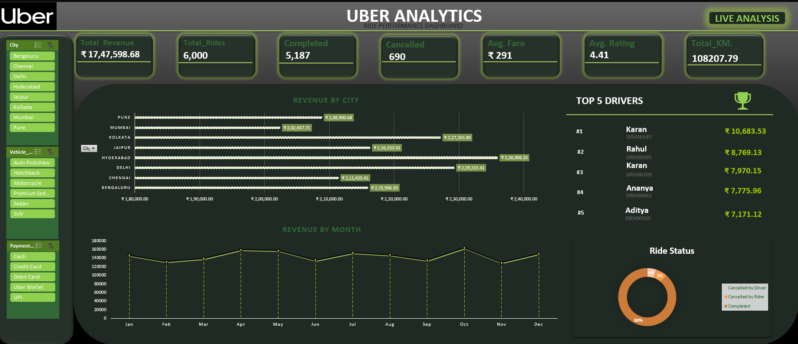

Project Overview

An interactive dashboard analysing 6,000+ Uber ride records to understand revenue, driver performance and ride trends.

Tools & Technologies
- Microsoft Excel
- Power Pivot
- Pivot Tables & Charts
- Data Visualization

Dashboard Preview

Key Features
- Total Revenue Analysis
- Monthly Revenue Trends
- Top 5 Driver Performance
- Ride Status Analysis
- Interactive Slicers
  
Key Insights
- Total rides: 6,000
- Completed rides: 5,187
- Total revenue: ₹17,47,598.68
